  

  
  
  
  
  
  
  

  

## How I work

  

## What I'm building

**[shironigun/marketplace](https://github.com/shironigun/marketplace)**: 10 Claude Code plugins and 38 skills, each built for one real job. Every plugin shows its work and waits for a person's yes before it writes anywhere.

  

<table>
  <tr>
    <td width="50%" valign="top"></td>
    <td width="50%" valign="top"></td>
  </tr>
  <tr>
    <td width="50%" valign="top"></td>
    <td width="50%" valign="top"> Co-authored with <a href="https://github.com/aishaimt002">Ayesha Imtiaz</a>.</td>
  </tr>
</table>

<b>All 10 plugins</b>

 

| Plugin | What it does |
|---|---|
| [qa-engineering](https://github.com/shironigun/marketplace/tree/main/plugins/qa-engineering) | The whole QA loop in one orchestrator |
| [qa-toolkit](https://github.com/shironigun/marketplace/tree/main/plugins/qa-toolkit) | Light QA building blocks |
| [api-testing](https://github.com/shironigun/marketplace/tree/main/plugins/api-testing) | API cases and Playwright specs, both ways |
| [ui-testing](https://github.com/shironigun/marketplace/tree/main/plugins/ui-testing) | UI test cases and Playwright UI specs |
| [bug-suite](https://github.com/shironigun/marketplace/tree/main/plugins/bug-suite) | Bugs, defects and comments in house style |
| [release-notes-suite](https://github.com/shironigun/marketplace/tree/main/plugins/release-notes-suite) | From what shipped to what customers read |
| [feature-explainer](https://github.com/shironigun/marketplace/tree/main/plugins/feature-explainer) | A visual explainer page for any reader |
| [how-to-guides](https://github.com/shironigun/marketplace/tree/main/plugins/how-to-guides) | Customer how-to guides as branded PDFs |
| [design-intelligence](https://github.com/shironigun/marketplace/tree/main/plugins/design-intelligence) | From a Figma screen to compliant MUI code, co-authored with [Ayesha Imtiaz](https://github.com/aishaimt002) |
| [standout](https://github.com/shironigun/marketplace/tree/main/plugins/standout) | A LinkedIn revamp built from facts you can back |

## Tools I work with

  
  
  
  
  
  
  
  
  

## Certified

  

## On GitHub

  
  

<b>Skills</b>

 

| | |
|---|---|
| **Product** | Product discovery · Product roadmapping · Business analysis · Software requirements |
| **Design** | User experience (UX) · User interface prototyping · Design review |
| **AI** | AI agents · LLM evaluation · Prompt engineering · Rapid prototyping |
| **Quality** | Test automation · API testing · Test planning · Defect triage |
| **Leadership** | Coaching · Mentoring · Workshop facilitation · Scrum |

## Connect with me

  
  
  
  

 

Ask me about AI evaluation, agentic workflows, and teams that build with AI. The little agent up top also lives on my portfolio, where it sulks if you click it too often.

