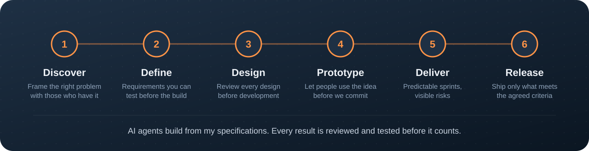
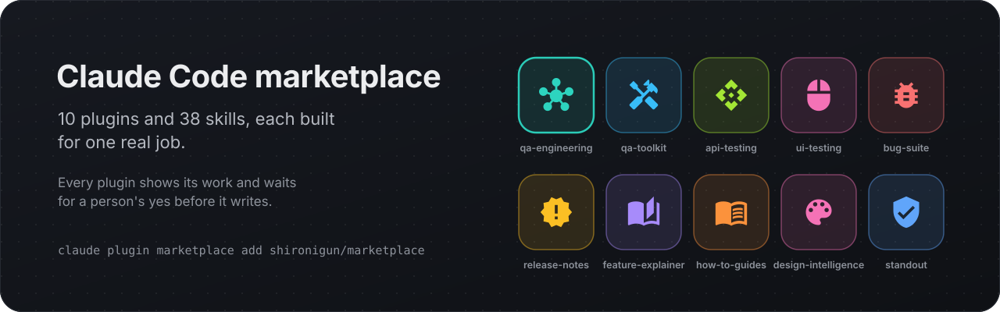
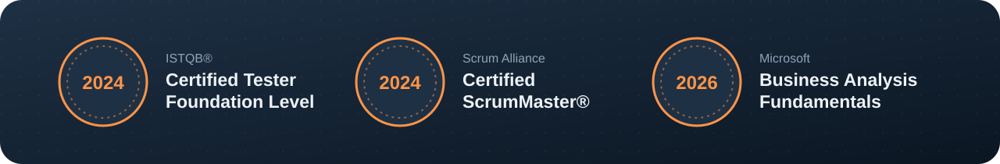

  

  
  
  
  
  
  
  

  

## How I work

  

## What I'm building

  

<b>All 10 plugins</b> (open to see each one)

 

<table>
  <tr>
    <td width="50%" valign="top"></td>
    <td width="50%" valign="top"></td>
  </tr>
  <tr>
    <td width="50%" valign="top"></td>
    <td width="50%" valign="top"></td>
  </tr>
  <tr>
    <td width="50%" valign="top"></td>
    <td width="50%" valign="top"></td>
  </tr>
  <tr>
    <td width="50%" valign="top"></td>
    <td width="50%" valign="top"></td>
  </tr>
  <tr>
    <td width="50%" valign="top"> Co-authored with <a href="https://github.com/aishaimt002">Ayesha Imtiaz</a>.</td>
    <td width="50%" valign="top"></td>
  </tr>
</table>

## Tools I work with

  
  
  
  
  
  
  
  
  

## Certified

  

<b>Skills</b>

 

| | |
|---|---|
| **Product** | Product discovery · Product roadmapping · Business analysis · Software requirements |
| **Design** | User experience (UX) · User interface prototyping · Design review |
| **AI** | AI agents · LLM evaluation · Prompt engineering · Rapid prototyping |
| **Quality** | Test automation · API testing · Test planning · Defect triage |
| **Leadership** | Coaching · Mentoring · Workshop facilitation · Scrum |

 

Ask me about AI evaluation, agentic workflows, and teams that build with AI. The little agent up top also lives on my portfolio, where it sulks if you click it too often.

