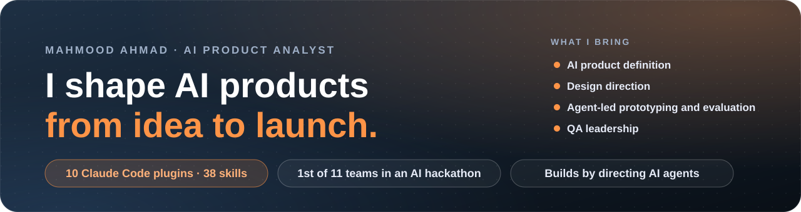

  

<h1 align="center">Hi 👋, I'm Mahmood Ahmad</h1>
<h3 align="center">AI Product Analyst. I shape AI products from idea to launch, and build them by directing AI agents.</h3>

  

  
  
  
  
   
  

## About me

- 🔭 I'm currently working on **[Claude Code marketplace: 10 plugins, 38 skills](https://github.com/shironigun/marketplace)**

- 🧭 At work, I'm leading **AI feature definition, prototyping and evaluation, alongside the QA team**

- 🌱 I'm currently learning **Machine Learning, AI Evaluation**

- 🧰 How I build: **I decide what to build, specify it and review every result; AI agents write the code**

- 💬 Ask me about **AI evaluation, agentic workflows, and teams that build with AI**

- 📫 How to reach me **shironigun@gmail.com**

- 👨‍💻 All of my projects are available at **[https://shironigun.github.io](https://shironigun.github.io)**

- 📄 Know about my experiences **[Resume (PDF)](https://shironigun.github.io/resumes/Mahmood_Ahmad_Resume.pdf)**

- ⚡ Fun fact **my portfolio has a small AI agent on a rope. Click it too often and it falls, runs a self-repair, and sulks**

## What I'm building

**[shironigun/marketplace](https://github.com/shironigun/marketplace)**: 10 Claude Code plugins and 38 skills, each built for one real job. Every plugin shows its work and waits for a person's yes before it writes anywhere.

  

<table>
  <tr>
    <td width="50%" valign="top"></td>
    <td width="50%" valign="top"></td>
  </tr>
  <tr>
    <td width="50%" valign="top"></td>
    <td width="50%" valign="top"> Co-authored with <a href="https://github.com/aishaimt002">Ayesha Imtiaz</a>.</td>
  </tr>
</table>

<b>All 10 plugins</b>

 

| Plugin | What it does |
|---|---|
| [qa-engineering](https://github.com/shironigun/marketplace/tree/main/plugins/qa-engineering) | The whole QA loop in one orchestrator |
| [qa-toolkit](https://github.com/shironigun/marketplace/tree/main/plugins/qa-toolkit) | Light QA building blocks |
| [api-testing](https://github.com/shironigun/marketplace/tree/main/plugins/api-testing) | API cases and Playwright specs, both ways |
| [ui-testing](https://github.com/shironigun/marketplace/tree/main/plugins/ui-testing) | UI test cases and Playwright UI specs |
| [bug-suite](https://github.com/shironigun/marketplace/tree/main/plugins/bug-suite) | Bugs, defects and comments in house style |
| [release-notes-suite](https://github.com/shironigun/marketplace/tree/main/plugins/release-notes-suite) | From what shipped to what customers read |
| [feature-explainer](https://github.com/shironigun/marketplace/tree/main/plugins/feature-explainer) | A visual explainer page for any reader |
| [how-to-guides](https://github.com/shironigun/marketplace/tree/main/plugins/how-to-guides) | Customer how-to guides as branded PDFs |
| [design-intelligence](https://github.com/shironigun/marketplace/tree/main/plugins/design-intelligence) | From a Figma screen to compliant MUI code, co-authored with [Ayesha Imtiaz](https://github.com/aishaimt002) |
| [standout](https://github.com/shironigun/marketplace/tree/main/plugins/standout) | A LinkedIn revamp built from facts you can back |

## Skills

| | |
|---|---|
| **Product** | Product discovery · Product roadmapping · Business analysis · Software requirements |
| **Design** | User experience (UX) · User interface prototyping · Design review |
| **AI** | AI agents · LLM evaluation · Prompt engineering · Rapid prototyping |
| **Quality** | Test automation · API testing · Test planning · Defect triage |
| **Leadership** | Coaching · Mentoring · Workshop facilitation · Scrum |

## Tools I work with

  
  
  
  
  
  
  
  
  

## Certified

  
  
  

## GitHub activity

  
  

## How I work

- **Product first:** the problem and the rules come before any code.
- **Facts before claims:** every number traces to a source, or it stays out.
- **People approve every write:** drafts first, then a yes, then the change.

<h3 align="left">Connect with me:</h3>

